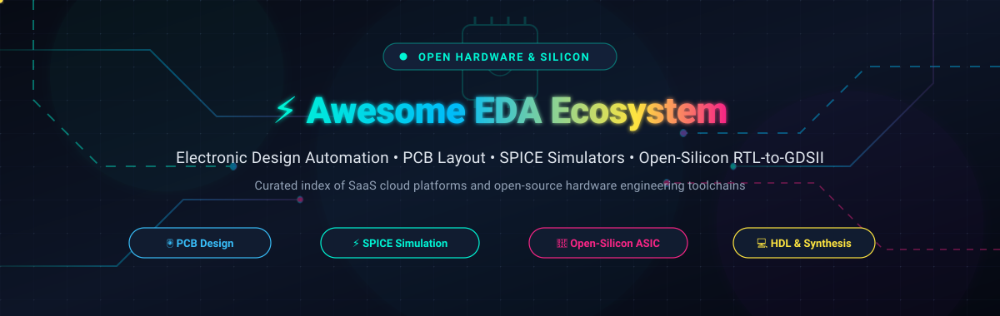

<div align="center">



# ⚡ Awesome Electronic Design Automation (EDA) Ecosystem 🔌

<a href="https://github.com/ishandutta2007/Awesome-Awesome-Awesome"></a><a href="https://discord.gg/jc4xtF58Ve"></a> <a href="https://github.com/ishandutta2007/Awesome-Electronic-Design-Automation-EDA/stargazers"></a> <a href="https://github.com/ishandutta2007/Awesome-Electronic-Design-Automation-EDA/network/members"></a> <a href="https://github.com/ishandutta2007/Awesome-Electronic-Design-Automation-EDA/blob/main/LICENSE"></a> <a href="https://github.com/ishandutta2007/Awesome-Electronic-Design-Automation-EDA/pulls"></a> <a href="https://github.com/ishandutta2007"></a>

**The definitive, SEO-optimized curated directory of enterprise SaaS solutions and open-source software for Electronic Design Automation (EDA), schematic capture, PCB layout, mixed-signal SPICE simulation, and open-silicon RTL-to-GDSII ASIC workflows.**

*Deterministic PCB Layout • High-Speed Routing • Mixed-Signal SPICE Simulation • Open-Silicon RTL-to-GDSII • Verilog/VHDL Verification • Microcontroller Co-Simulation*

</div>

---

## 📖 Table of Contents

- [🌐 Sector Overview & Market Dynamics](#-sector-overview--market-dynamics)
- [🏢 Enterprise SaaS & Hosted Cloud EDA Platforms](#-enterprise-saas--hosted-cloud-eda-platforms)
- [💻 Open-Source GitHub Projects](#-open-source-github-projects)
- [🧭 Decision Guide: Which EDA & Silicon Toolchain Should You Choose?](#-decision-guide-which-eda--silicon-toolchain-should-you-choose)
- [🧩 Architectural Comparison: PCB vs Open-Silicon Flows](#-architectural-comparison-pcb-vs-open-silicon-flows)
- [🤝 How to Contribute](#-how-to-contribute)
- [💖 Support](#-support)
- [📈 Star History](#-star-history)
- [⚠️ Disclaimer](#️-disclaimer)
- [📄 License](#-license)
- [🏷️ Tags & Search Taxonomy](#️-tags--search-taxonomy)

---

## 🌐 Sector Overview & Market Dynamics

The global **Electronic Design Automation (EDA) and Silicon Design Software market** was valued at approximately **$15.2 billion in 2024** and is projected to surpass **$28.5 billion by 2032**, expanding at a compound annual growth rate (**CAGR of ~10.2%**). Growth is propelled by escalating semiconductor complexity, bespoke AI acceleration silicon (TPUs, NPUs), 3D multi-die chiplet packaging, automotive electrification, and high-frequency 5G/6G RF hardware.

The sector demonstrates a **bifurcated market structure**:
- **Core Semiconductor IC Design (Silicon Level):** Characterized by a **highly concentrated, oligopolistic landscape**. The "Big Three" EDA giants—**Synopsys**, **Cadence Design Systems**, and **Siemens EDA (Mentor Graphics)**—command over **75%** of worldwide commercial logic synthesis, place-and-route, sign-off, and formal verification revenue, reinforced by deep patent portfolios, foundry certification barriers, and multi-million-dollar multi-year enterprise contracts.
- **PCB Design & Board-Level Systems:** Displays **moderate fragmentation**. Enterprise players like **Altium (Renesas)**, **Cadence (OrCAD/Allegro)**, and **Zuken** compete alongside browser-based agile SaaS entrants (**EasyEDA**, **Flux.ai**, **Quilter AI**). Concurrently, a vibrant, battle-tested open-source ecosystem anchored by **KiCad** for printed circuit boards and **OpenROAD / Yosys** for automated RTL-to-GDSII ASIC fabrication has democratized physical design without proprietary licensing lock-in.

---

## 🏢 Enterprise SaaS & Hosted Cloud EDA Platforms

The following commercial SaaS solutions and cloud-hosted EDA environments deliver browser-based collaborative schematic capture, cloud simulation clusters, autonomous autorouting, and manufacturing BOM management. Entries are sorted in **descending order by company scale (valuation / market capitalization / annual revenue)**.

| 🏢 Platform / Product | 💼 Company Scale (Valuation / Revenue) | 💵 Starting Tier Pricing | 🎁 Free Tier Limits (Free Forever / Trial) | 🚀 Core Capabilities & Target Use Case |
| :--- | :--- | :--- | :--- | :--- |
| **[Siemens EDA (PADS Pro Cloud / Questa)](https://eda.sw.siemens.com/)** | **~$140B Valuation**<br>*(Siemens AG Market Cap / ~$82B Annual Revenue)* | **$395 / month**<br>*(PADS Professional Cloud seat; or $2,400/year base desktop license)* | **30-day full-featured free trial** of PADS Professional with cloud collaboration, schematic capture, layout, and sample design rule sets | Enterprise multi-layer PCB layout, constraint management, thermal and signal integrity co-simulation, and seamless integration into the Siemens Xcelerator PLM portfolio. |
| **[Synopsys Cloud](https://www.synopsys.com/cloud.html)** | **~$85B Valuation**<br>*(Market Cap / ~$6.1B Annual Revenue)* | **$1,500 / month**<br>*(Baseline SaaS commitment; or by-the-minute metered usage via FlexEDA)* | **30-day guided evaluation trial** with pre-configured virtual compute environments and demonstration silicon IP flows | Cloud-native semiconductor EDA platform providing browser-accessible logic synthesis (Design Compiler), digital verification, and physical sign-off on scalable AWS/Azure compute clusters. |
| **[Cadence OnCloud & OrCAD X](https://www.orcad.com/)** | **~$80B Valuation**<br>*(Cadence Market Cap / ~$4.6B Annual Revenue)* | **$120 / month**<br>*($1,440 billed annually for OrCAD X Standard Cloud; or $250 token packs for OnCloud)* | **30-day free trial** of OrCAD X Cloud (limited to 5 cloud workspace projects, full schematic entry, layout editing, and integrated PSpice simulation) | Unified cloud PCB and IC packaging suite with cloud vault library synchronization, real-time DRC, interactive high-speed routing, and native PSpice engine integration. |
| **[Autodesk Fusion 360 (EAGLE PCB)](https://www.autodesk.com/products/fusion-360/)** | **~$60B Valuation**<br>*(Autodesk Market Cap / ~$5.5B Annual Revenue)* | **$85 / month**<br>*(or $680 / year billed annually for commercial license)* | **Free Forever Personal Use tier** (non-commercial, max 10 active documents, 2 schematic sheets, 2 signal layers, 80cm² board area); 30-day unrestricted commercial trial | Tight parametric integration between mechanical (MCAD) enclosure modeling and electrical (ECAD) printed circuit board design, 3D clearance checking, and CAM manufacturing export. |
| **[Altium 365 & Altium Designer](https://www.altium.com/)** | **~$35B Valuation**<br>*(Parent Renesas Electronics MCap; Altium acquired for $5.9B) / ~$10B combined Rev* | **$385 / month**<br>*($3,850 billed annually for Altium Designer Standard with Altium 365 cloud seat)* | **Free Forever Altium 365 Viewer** (unlimited browser-based viewing, measuring, commenting, and BOM inspection of CAD and Gerber files); 15-day unrestricted commercial trial | Industry benchmark in high-speed multi-layer PCB design, interactive length tuning, active routing engine, MCAD co-design, and real-time Octopart supply-chain BOM intelligence. |
| **[EasyEDA Pro](https://easyeda.com/)** | **~$2.5B Valuation**<br>*(Parent JLCPCB Group / ~$600M Annual Revenue)* | **$9.90 / month**<br>*(or $99 / year for EasyEDA Pro tier)* | **Free Forever Standard Edition** (unlimited personal projects, unlimited schematic sheets, up to 6 PCB layers, and access to 1.5M+ public components); 30-day Pro trial | Zero-install web EDA platform with direct real-time LCSC electronic component stock availability, interactive 3D PCB preview, and one-click fabrication ordering via JLCPCB. |
| **[Zuken eCADSTAR](https://www.ecadstar.com/)** | **~$800M Valuation**<br>*(Zuken Inc. Market Cap / ~$290M Annual Revenue)* | **$199 / month**<br>*($2,388 billed annually for eCADSTAR Base PCB Design Suite)* | **30-day full evaluation license** with complete schematic capture, PCB layout, and access to sample high-density connector libraries | Connected internet-first PCB design environment combining 2D and 3D design environments, high-speed routing constraints, and enterprise manufacturing outputs for SME teams. |
| **[Flux.ai](https://www.flux.ai/)** | **~$30M Valuation**<br>*($16M Venture funding / Outrun Ventures, Liquid 2)* | **$15 / month**<br>*($180 billed annually for Flux Pro)* | **Free Forever Community tier** (unlimited public projects, 5 private projects, browser simulation, and AI Copilot assistance up to 50 AI prompts/month); 14-day Pro trial | Cloud-native collaborative browser EDA with real-time Google Docs-style multi-user editing, AI copilot for parts selection and net connection, and embedded SPICE simulator. |
| **[Proteus Design Suite](https://www.labcenter.com/)** | **~$25M Annual Revenue**<br>*(Labcenter Electronics / bootstrap leader)* | **$495 one-time license**<br>*(~$41/month amortized perpetual entry tier for PCB Level 1 + VSM)* | **Free Forever Interactive Demo version** (schematic capture, interactive SPICE/MCU simulation, virtual instruments included; file saving and gerber output disabled) | Real-time interactive co-simulation of microcontrollers (ARM Cortex, PIC, AVR, ESP32) with surrounding analog/digital hardware circuitry, schematic capture, and shape-based autorouting. |
| **[Quilter AI](https://www.quilter.ai/)** | **~$18M Valuation**<br>*($10M Series A led by Benchmark / Coatue)* | **$99 / month**<br>*(Quilter Pro subscription)* | **Free Forever Starter tier** (3 complete board compilations per month with standard physics constraints); 14-day free trial of Pro with unlimited autorouting compilations | Physics-informed autonomous PCB autorouting agent leveraging reinforcement learning to route dense multi-layer boards while honoring impedance and IPC/EMC thermal constraints. |

---

## 💻 Open-Source GitHub Projects

The open-source EDA ecosystem spans full PCB design suites, analog/mixed-signal SPICE simulators, Hardware Description Language (HDL) compilers, and automated silicon flows that take digital Verilog code all the way to fabricated ASIC tape-outs.

Entries are sorted in **descending order by GitHub Stars_Count**.

### 1. ⚡ [Yosys](https://github.com/YosysHQ/yosys) [](https://github.com/YosysHQ/yosys/stargazers)
- **Primary Role**: Open-source framework for Verilog RTL synthesis and formal verification.
- **Primary Language**: C++ | **License**: ISC License
- **Highlights**:
  - The universal synthesis backbone of the open-silicon toolchain, mapping Verilog behavioral logic into gate-level netlists.
  - Supports extensive ASIC technology mapping and modern FPGA architectures (Lattice iCE40, ECP5, Xilinx 7-Series).
  - Built-in SAT solver integration for property checking and formal verification via `symbiyosys`.
- **Target Use Case**: Digital ASIC synthesis pipelines and open-source FPGA toolchains.

---

### 2. 🏗️ [Chisel](https://github.com/chipsalliance/chisel) [](https://github.com/chipsalliance/chisel/stargazers)
- **Primary Role**: Advanced hardware construction language embedded in Scala.
- **Primary Language**: Scala | **License**: Apache-2.0
- **Highlights**:
  - Brings modern object-oriented and functional software engineering paradigms to digital circuit design.
  - Highly parameterized hardware generator engine; powers the open-source RISC-V Rocket Chip and BOOM processor cores.
  - Compiles directly to FIRRTL (Flexible Intermediate Representation for RTL) and synthesizable Verilog.
- **Target Use Case**: Parameterized SoC generators and modern RISC-V processor architecture design.

---

### 3. 🚀 [Verilator](https://github.com/verilator/verilator) [](https://github.com/verilator/verilator/stargazers)
- **Primary Role**: High-performance cycle-accurate SystemVerilog simulator and linter.
- **Primary Language**: C++ | **License**: LGPL-3.0 / Artistic-2.0
- **Highlights**:
  - Compiles synthesizable SystemVerilog code directly into multithreaded, highly optimized C++ or SystemC models.
  - Orders of magnitude faster than conventional interpreted event-driven event-wheel simulators (10x–100x speedup).
  - The gold standard for pre-silicon digital logic verification, regression suites, and software-in-the-loop emulation.
- **Target Use Case**: Cycle-accurate logic simulation and massive automated regression test suites.

---

### 4. 📟 [Icarus Verilog](https://github.com/steveicarus/iverilog) [](https://github.com/steveicarus/iverilog/stargazers)
- **Primary Role**: Event-driven Verilog simulation and synthesis execution tool.
- **Primary Language**: C++ | **License**: GPL-2.0
- **Highlights**:
  - Implements the IEEE 1364-2005 Verilog standard with active SystemVerilog extensions.
  - Generates intermediate VVP runtime code for simulation or netlists for targeted synthesis.
  - Excellent pairing with GTKWave for interactive waveform debugging in university courses and developer testbenches.
- **Target Use Case**: Educational digital design, testbench simulation, and waveform visualization.

---

### 5. 🔬 [OpenROAD](https://github.com/The-OpenROAD-Project/OpenROAD) [](https://github.com/The-OpenROAD-Project/OpenROAD/stargazers)
- **Primary Role**: Autonomous 24-hour, no-human-in-the-loop RTL-to-GDSII physical ASIC design flow.
- **Primary Language**: C++ / Python | **License**: BSD-3-Clause
- **Highlights**:
  - DARPA IDEA-backed autonomous silicon compilation system that eliminates manual tape-out iteration.
  - Integrates floorplanning, I/O placement, power distribution network (PDN) generation, global/detailed placement, clock tree synthesis (CTS), and routing.
  - Fully production-validated across commercial nodes down to 12nm/16nm as well as open PDKs (SkyWater 130nm, IHP 130nm, GF180MCU).
- **Target Use Case**: Rapid autonomous physical layout from synthesized gate netlist to tape-out-ready GDSII/OASIS.

---

### 6. 🖲️ [KiCad](https://github.com/KiCad/kicad-source-mirror) [](https://github.com/KiCad/kicad-source-mirror/stargazers)
- **Primary Role**: The premier open-source multi-sheet schematic capture and multi-layer PCB layout suite.
- **Primary Language**: C++ / Python | **License**: GPL-3.0
- **Highlights**:
  - Full-featured professional suite with modern schematic editor, 32+ layer PCB routing, high-density DRC rules, and 3D raytraced board rendering.
  - Integrated push-and-shove interactive routing engine for differential pairs, impedance tuning, and bus routing.
  - Python scripting API for custom automated plugins, BOM generators, and manufacturing fab-house exports.
- **Target Use Case**: Professional and hobbyist PCB hardware design from schematic capture to Gerber/drill production.

---

### 7. 🧼 [LibrePCB](https://github.com/LibrePCB/LibrePCB) [](https://github.com/LibrePCB/LibrePCB/stargazers)
- **Primary Role**: Modern, intuitive, and modular cross-platform PCB design software.
- **Primary Language**: C++ (Qt) | **License**: GPL-3.0
- **Highlights**:
  - Clean human-friendly user interface with strict data architecture separating symbols, packages, and components.
  - Built-in online library manager with automated updates and strict schematic-to-layout synchronization.
  - Human-readable file formats version-controlled effortlessly with Git.
- **Target Use Case**: Beginners, makers, and agile hardware teams seeking a clean alternative to legacy EDA suites.

---

### 8. 📦 [GHDL](https://github.com/ghdl/ghdl) [](https://github.com/ghdl/ghdl/stargazers)
- **Primary Role**: Complete open-source VHDL simulator, compiler, and synthesis frontend.
- **Primary Language**: Ada / C++ | **License**: GPL-2.0
- **Highlights**:
  - Translates VHDL files directly to native machine code using LLVM, GCC, or an internal mcode engine.
  - Full support for IEEE 1076-1987, 1993, 2002, and 2008 standards.
  - Direct synthesis integration into Yosys via the `ghdl-yosys-plugin`.
- **Target Use Case**: VHDL digital design compilation, simulation, and synthesis.

---

### 9. 🐍 [cocotb](https://github.com/cocotb/cocotb) [](https://github.com/cocotb/cocotb/stargazers)
- **Primary Role**: Coroutine-based Python testbench verification framework for digital logic.
- **Primary Language**: Python / C++ | **License**: BSD-3-Clause
- **Highlights**:
  - Test RTL modules (Verilog, SystemVerilog, VHDL) using standard Python rather than verbose SystemVerilog testbenches.
  - Interfaces seamlessly with Verilator, Icarus Verilog, GHDL, Questa, and Cadence Xcelium via VPI/VHPI.
  - Enables powerful Python data science packages (NumPy, PyTorch) for hardware verification and golden model validation.
- **Target Use Case**: Agile digital verification, algorithmic hardware co-verification, and CI test automation.

---

### 10. 🔄 [FreeRouting](https://github.com/freerouting/freerouting) [](https://github.com/freerouting/freerouting/stargazers)
- **Primary Role**: Advanced routing engine for printed circuit boards with Specctra DSN netlist support.
- **Primary Language**: Java | **License**: GPL-3.0
- **Highlights**:
  - Plugs into KiCad, LibrePCB, and other EDA tools accepting standard `.dsn` files.
  - Capable of complete multi-layer topological autorouting with clearance and via-minimization optimization.
  - Interactive manual routing assistance with obstacle avoidance.
- **Target Use Case**: Automated multi-layer PCB trace routing and density optimization.

---

### 11. 🧬 [SpinalHDL](https://github.com/SpinalHDL/SpinalHDL) [](https://github.com/SpinalHDL/SpinalHDL/stargazers)
- **Primary Role**: High-level Scala-based hardware description language for clean digital design.
- **Primary Language**: Scala | **License**: LGPL-3.0
- **Highlights**:
  - Eliminates common Verilog/VHDL syntax bugs (unassigned signals, inadvertent latches, combinatorial loops) at compile time.
  - Rich standard library of digital IP (FIFOs, AXI/APB bus arbiters, UART, memory controllers).
  - Emits clean, readable, industry-standard Verilog and VHDL.
- **Target Use Case**: Complex SoC bus architectures, arithmetic pipelines, and modern digital IP cores.

---

### 12. 🛣️ [OpenLane](https://github.com/The-OpenROAD-Project/OpenLane) [](https://github.com/The-OpenROAD-Project/OpenLane/stargazers)
- **Primary Role**: Automated RTL-to-GDSII ASIC design flow hardening silicon macros and chips.
- **Primary Language**: Python / Tcl | **License**: Apache-2.0
- **Highlights**:
  - Orchestrates Yosys, OpenROAD, Magic, Netgen, and KLayout into a reproducible containerized ASIC flow.
  - Fully calibrated against Google/SkyWater 130nm, GlobalFoundries 180nm, and IHP 130nm open-source PDKs.
  - Includes design exploration, DRC/LVS physical verification, and static timing analysis (STA).
- **Target Use Case**: Full automated hardening of RISC-V SoCs and digital ASIC macros for tape-out.

---

### 13. 🧰 [FuseSoC](https://github.com/olofk/fusesoc) [](https://github.com/olofk/fusesoc/stargazers)
- **Primary Role**: Package manager and build abstraction tool for HDL cores and SoC design.
- **Primary Language**: Python | **License**: BSD-2-Clause
- **Highlights**:
  - Manages dependencies for hardware IP blocks using standardized `.core` descriptor files.
  - Unified abstraction that drives diverse FPGA tools (Vivado, Quartus) and simulators (Verilator, Icarus, Modelsim).
  - Powers continuous integration and reuse in major open-source hardware repositories (OpenTitan, SweRV).
- **Target Use Case**: Modular SoC assembly, IP core package management, and multi-tool build pipelines.

---

### 14. 🎛️ [Qucs-S](https://github.com/ra3xdh/qucs_s) [](https://github.com/ra3xdh/qucs_s/stargazers)
- **Primary Role**: Universal schematic capture GUI for ngspice, Xyce, and RF circuit simulation.
- **Primary Language**: C++ (Qt) | **License**: GPL-2.0
- **Highlights**:
  - Bridges modern GUI schematic capture with industrial simulation backends (ngspice, Xyce, Qucsator).
  - Native support for RF S-parameter simulation, Smith charts, noise analysis, and harmonic balance.
  - Clean plotting window for parametric sweeps, Monte Carlo analysis, and Bode plots.
- **Target Use Case**: Analog and RF circuit design, frequency-domain analysis, and educational SPICE labs.

---

### 15. 📐 [Horizon EDA](https://github.com/horizon-eda/horizon) [](https://github.com/horizon-eda/horizon/stargazers)
- **Primary Role**: Modern PCB design package with pooled SQLite library architecture.
- **Primary Language**: C++ | **License**: GPL-3.0
- **Highlights**:
  - Centralized SQLite database library preventing footprint/symbol duplication and netlist drift.
  - Interactive routing with real-time push-and-shove and continuous design rule enforcement.
  - Native 3D rendering and OpenGL accelerated layout engine.
- **Target Use Case**: Multi-layer board designers seeking strict library consistency and tight rule validation.

---

### 16. 🔍 [KLayout](https://github.com/KLayout/klayout) [](https://github.com/KLayout/klayout/stargazers)
- **Primary Role**: High-performance semiconductor mask layout viewer, editor, and DRC/LVS engine.
- **Primary Language**: C++ / Ruby / Python | **License**: GPL-3.0
- **Highlights**:
  - Blazing-fast visualization of massive gigabyte-scale GDSII, OASIS, and CIF mask layout databases.
  - Integrated 2D/3D cross-section viewer and programmable Design Rule Checking (DRC) engine.
  - Extensible via Python and Ruby APIs for automated layout generation and macro verification.
- **Target Use Case**: Silicon mask inspection, manual ASIC layout edits, and DRC rule deck execution.

---

### 17. 🐍 [PySpice](https://github.com/PySpice-org/PySpice) [](https://github.com/PySpice-org/PySpice/stargazers)
- **Primary Role**: Python programming interface for ngspice and Xyce circuit simulators.
- **Primary Language**: Python | **License**: GPL-3.0
- **Highlights**:
  - Script analog and mixed-signal circuit simulations programmatically using Python syntax.
  - Directly exposes simulation vectors to NumPy arrays, SciPy signal processing, and Matplotlib graphs.
  - Facilitates algorithmic component optimization, sensitivity analysis, and tolerance sweeps.
- **Target Use Case**: Parametric circuit simulation, programmatic optimization, and automated SPICE testing.

---

### 18. 📡 [openEMS](https://github.com/thliebig/openEMS) [](https://github.com/thliebig/openEMS/stargazers)
- **Primary Role**: Open-source 3D electromagnetic field simulator based on the FDTD method.
- **Primary Language**: C++ / Octave / MATLAB | **License**: GPL-3.0
- **Highlights**:
  - Full-wave 3D Finite-Difference Time-Domain (FDTD) electromagnetic field solver.
  - Analyzes high-frequency S-parameters, antenna radiation patterns, and PCB microstrip signal integrity.
  - Clean MATLAB and GNU Octave scripting interface for parametric geometry definition.
- **Target Use Case**: High-speed PCB trace signal integrity, RF antenna design, and EMC compliance simulation.

---

### 19. 🧙 [Magic VLSI](https://github.com/RTimothyEdwards/magic) [](https://github.com/RTimothyEdwards/magic/stargazers)
- **Primary Role**: Venerable interactive VLSI layout editor, extractor, and DRC checker.
- **Primary Language**: C / Tcl | **License**: MIT / Berkeley License
- **Highlights**:
  - The cornerstone layout and DRC engine of the open-silicon revolution; widely used with SkyWater 130nm PDK.
  - Continuous background design rule checking (DRC) highlighting violations during manual drawing.
  - Hierarchical circuit extraction and parasitics extraction for SPICE LVS (Layout vs Schematic) sign-off.
- **Target Use Case**: Analog and mixed-signal silicon layout, custom cell generation, and physical extraction.

---

### 20. 📜 [Surelog](https://github.com/chipsalliance/surelog) [](https://github.com/chipsalliance/surelog/stargazers)
- **Primary Role**: Comprehensive SystemVerilog IEEE 1800-2017 pre-processor, parser, and elaborator.
- **Primary Language**: C++ | **License**: Apache-2.0
- **Highlights**:
  - CHIPS Alliance initiative providing complete, standards-compliant parsing for modern SystemVerilog.
  - Generates Universal Hardware Data Model (UHDM) AST representation accessible by open-source compilers.
  - Seamlessly integrates with Yosys for SystemVerilog synthesizability.
- **Target Use Case**: Modern SystemVerilog AST generation, parsing, and advanced compiler backends.

---

### 21. 🔌 [ngspice](https://github.com/ngspice/ngspice) [](https://github.com/ngspice/ngspice/stargazers)
- **Primary Role**: The de facto open-source mixed-signal, mixed-level SPICE circuit simulator.
- **Primary Language**: C | **License**: BSD-3-Clause
- **Highlights**:
  - Evolution of Berkeley SPICE3f5, Cider1b1, and XSPICE with active 2026 ongoing development.
  - Supports non-linear DC, AC, transient, Fourier, noise, and sensitivity analysis.
  - Compatible with standard commercial netlists from OrCAD, Altium, and KiCad; embedded inside KiCad's schematic editor.
- **Target Use Case**: General-purpose analog circuit simulation, PCB signal analysis, and educational labs.

---

### 22. ⚡ [Xyce](https://github.com/Xyce/Xyce) [](https://github.com/Xyce/Xyce/stargazers)
- **Primary Role**: High-performance, massively parallel SPICE circuit simulator from Sandia National Laboratories.
- **Primary Language**: C++ | **License**: GPL-3.0
- **Highlights**:
  - Engineered for high-performance computing (HPC) clusters to solve circuits with tens of millions of devices.
  - Advanced distributed-memory parallel matrix solvers (Trilinos library integration).
  - Certified radiation-hardened model libraries and thermal co-simulation capabilities.
- **Target Use Case**: Massive mixed-signal circuit simulations, HPC semiconductor research, and radiation modeling.

---

## 🧭 Decision Guide: Which EDA & Silicon Toolchain Should You Choose?

| Engineering Scenario | Primary Recommendation | Complementary Tool | Key Architectural Rationale |
| :--- | :--- | :--- | :--- |
| **Professional / Production PCB Design** | **KiCad** | **FreeRouting** | Full schematic-to-Gerber flow, active DRC push-and-shove routing, no proprietary file formats or subscription lock-in. |
| **Rapid Prototype & Fab-Ordered Boards** | **EasyEDA Pro** | **JLCPCB / LCSC** | Zero setup required; instant component stock synchronization with 1.5M+ SMT parts and direct PCB assembly ordering. |
| **Enterprise Multi-Board / High-Speed Systems** | **Altium 365** or **Cadence Allegro** | **Ansys HFSS** | Industry standard constraint management, real-time supply chain pricing, and dedicated high-speed signal integrity sign-off. |
| **Analog / RF Circuit Simulation** | **ngspice** or **Qucs-S** | **PySpice** | Fast transient/AC sweeps, RF S-parameter calculations, and Python parametric scriptability. |
| **High-Frequency RF & Antenna Analysis** | **openEMS** | **GNU Octave / MATLAB** | 3D full-wave FDTD simulation without expensive commercial electromagnetic suite licensing. |
| **Digital Logic Verification & Simulation** | **Verilator** | **cocotb** | Unmatched cycle-accurate C++ simulation speed paired with high-level Python testbench verification. |
| **Modern Parameterized Silicon Design** | **Chisel** or **SpinalHDL** | **Verilator** | Type-safe, object-oriented hardware generation producing synthesizable Verilog for complex RISC-V SoCs. |
| **Autonomous Silicon Tape-Out (RTL-to-GDSII)** | **OpenLane** | **OpenROAD & KLayout** | End-to-end automated physical implementation and mask verification for open PDKs (SkyWater 130nm, IHP 130nm). |

---

## 🧩 Architectural Comparison: PCB vs Open-Silicon Flows

```
┌────────────────────────────────────────────────────────────────────────┐
│                   BOARD-LEVEL PCB DESIGN FLOW                          │
│                                                                        │
│   [Schematic Capture] ────> [Netlist Generation] ───> [Component Vault]│
│         (KiCad / LibrePCB)         │                       │           │
│                                    ▼                       ▼           │
│                           [Interactive Layout & Routing]               │
│                                (KiCad / FreeRouting)                   │
│                                    │                                   │
│                                    ▼                                   │
│                           [DRC & 3D Clearance Check]                   │
│                                    │                                   │
│                                    ▼                                   │
│                        [Gerber / ODB++ Manufacturing]                  │
└────────────────────────────────────────────────────────────────────────┘

┌────────────────────────────────────────────────────────────────────────┐
│                OPEN-SILICON ASIC RTL-TO-GDSII FLOW                     │
│                                                                        │
│   [Hardware Code: Verilog / Chisel / SpinalHDL]                        │
│                         │                                              │
│                         ▼                                              │
│   [Verification: Verilator + cocotb Testbenches]                       │
│                         │                                              │
│                         ▼                                              │
│   [Logic Synthesis & Technology Mapping: Yosys]                        │
│                         │                                              │
│                         ▼                                              │
│   [Autonomous Physical Design: OpenROAD (OpenLane)]                    │
│   ├── Floorplanning & Power Grid (PDN)                                 │
│   ├── Global & Detailed Placement                                      │
│   ├── Clock Tree Synthesis (CTS)                                       │
│   └── Global & Detailed Routing                                        │
│                         │                                              │
│                         ▼                                              │
│   [Sign-Off & Physical Verification: Magic + Netgen + KLayout]         │
│   ├── Design Rule Check (DRC)                                          │
│   ├── Layout Versus Schematic (LVS)                                    │
│   └── Static Timing Analysis (STA)                                     │
│                         │                                              │
│                         ▼                                              │
│       [Tape-Out Ready: GDSII / OASIS Fabrication File]                 │
└────────────────────────────────────────────────────────────────────────┘
```

---

## 🤝 How to Contribute

Contributions from electrical engineers, PCB designers, silicon architects, and software developers are warmly encouraged!

1. 🍴 **Fork the repository** to your GitHub account: [Awesome-Electronic-Design-Automation-EDA](https://github.com/ishandutta2007/Awesome-Electronic-Design-Automation-EDA).
2. 🌿 **Create a descriptive feature branch**: `git checkout -b feature/add-new-eda-tool`.
3. 📝 **Add or update an entry** in `README.md`:
   - For SaaS products: include official product link, parent company scale (valuation/revenue), specific starting tier price, and concrete free tier/trial limits.
   - For open-source projects: include repository link, social Stars_Badge linking to `/stargazers`, license, and concise description.
4. 🧪 Verify all links, markdown tables, and badge formatting.
5. 📬 **Submit a Pull Request** with a clear explanation of why the addition benefits the hardware community!

Discover more curated indexes in [Awesome-Awesome-Awesome](https://github.com/ishandutta2007/Awesome-Awesome-Awesome).

---

## 💖 Support

A huge **thank you** to all electronics engineers, hardware designers, PCB layout artists, chip architects, and open-silicon researchers who support and advance this ecosystem! 🎉

If this curated directory has saved you research time, assisted your board design, or guided your ASIC tape-out, please consider supporting the project:

- ⭐ **Star this repository** to improve visibility and help other hardware builders discover it.
- 🍴 **Fork and contribute** by submitting new open-source EDA tools, board designers, or silicon flows.
- 📢 **Share with the community** across your team, university lab, Discord, LinkedIn, and Twitter/X.
- ☕ **Buy a coffee & Sponsor**: Back ongoing curation, benchmarking, and research via the [GitHub Sponsor Dashboard](https://github.com/sponsors/ishandutta2007).

<p align="center">
  <a href="https://github.com/sponsors/ishandutta2007">
    
  </a>
</p>

---

## 📈 Star History

[](https://star-history.dera.page/#ishandutta2007/Awesome-Electronic-Design-Automation-EDA&type=date&legend=top-left)

---

## ⚠️ Disclaimer

- This is an **independently curated community guide** for educational, engineering, and architectural research purposes. Mention of commercial vendors or open-source projects does not imply formal endorsement.
- Pricing tiers, free quotas, and feature sets change over time; always confirm specific contractual terms on each vendor's official website before making enterprise architectural commitments.
- Open-source silicon PDKs and ASIC flows vary in maturity; verify tape-out outputs against target foundry sign-off requirements (DRC/LVS) prior to mask submission.

---

## 📄 License

This repository is distributed under the **[MIT License](LICENSE)**. Open source, community-first, and freely shareable.

---

## 🏷️ Tags & Search Taxonomy

`electronic-design-automation` • `eda` • `pcb-design` • `circuit-simulation` • `open-source-hardware` • `kicad` • `openroad` • `yosys` • `verilog` • `systemverilog` • `vhdl` • `chisel` • `verilator` • `ngspice` • `spice` • `xyce` • `openems` • `klayout` • `magic-vlsi` • `asic` • `rtl-to-gdsii` • `fpga` • `cadence` • `altium` • `synopsys` • `siemens-eda` • `easyeda`

<div align="center">
  <b>Built with ⚡ for Electronics Engineers, PCB Designers & Silicon Architects worldwide.</b>
</div>
